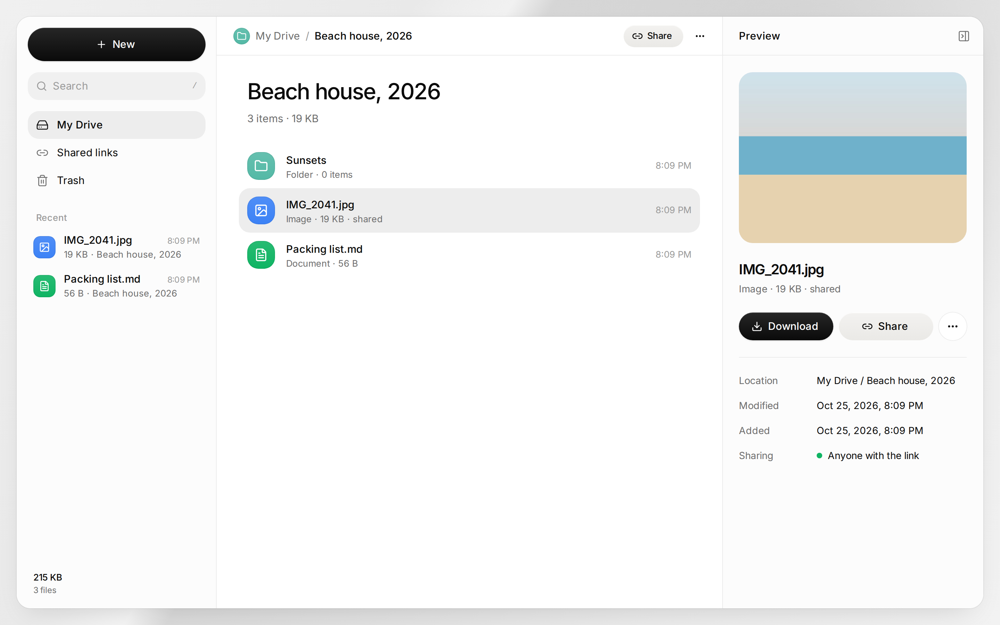

# midden

A small, self-hosted Google Drive for one person. It runs on your own Cloudflare account, on the free
plan: a Worker for the app, D1 for folder and file names, and R2 for the file data.

> A _midden_ is the pile where a red squirrel keeps its pine cones.



- Upload files and whole folders, with large files in parts
- Folders, rename, move, trash, and restore
- Previews for images, video, audio, PDF, and text
- Share links for files and folders, with an optional password and expiry date
- Search, recent files, and storage use
- Save a file from a link

## Set up

[](https://deploy.workers.cloudflare.com/?url=https://github.com/andrewcoul/midden)

1. Click **Deploy to Cloudflare** and sign in to Cloudflare. Cloudflare copies this repository to your
   GitHub account, creates the D1 database and the R2 bucket, and deploys midden. Each push to your
   copy deploys again.
2. Open your midden at `https://midden.<your-subdomain>.workers.dev`. It shows a setup page and no
   files until you turn on Cloudflare Access (see below).

The deploy asks for no secrets. midden creates its database tables when it starts, so you do not
need to run migrations.

midden has no password of its own. Cloudflare Access signs you in, with your Cloudflare login or with
any identity provider that Access supports. Access stops other visitors before they get to midden.

### Sign in with Cloudflare Access

1. In the Cloudflare dashboard, open **Workers & Pages → midden → Settings**.
2. Under **Domains & Routes**, click **Enable Cloudflare Access** next to `workers.dev`. By default,
   members of your Cloudflare account can sign in. To change this, click **Manage Cloudflare Access**.
3. Open midden again and sign in. The setup page now shows two values.
4. Add the two values under **Settings → Variables and Secrets**:

   | Name                        | Value                                      |
   | --------------------------- | ------------------------------------------ |
   | `MIDDEN_ACCESS_TEAM_DOMAIN` | Your team, `https://<team>.cloudflareaccess.com` |
   | `MIDDEN_ACCESS_AUD`         | The Application Audience (AUD) tag         |

midden checks the signed Access token on each request: the signature, the team, and the audience.
Midden does not trust a request only because it has an Access header.

**Keep share links public.** Access blocks every path, so people without a sign-in cannot open your
share links. To let them in, add a second Access application in **Zero Trust → Access → Applications**
for these paths on the same hostname, with a **Bypass** policy for **Everyone**:

```
/s/*
/api/s/*
/assets/*
/favicon.svg
```

These paths show only the items that you share. Share links with a password still need their
password, and midden locks out an address after 10 wrong passwords in 15 minutes.

### Settings

All settings are optional. Set them under **Settings → Variables and Secrets**. A change deploys
again in a few seconds.

| Name                        | What it does                                                                |
| --------------------------- | --------------------------------------------------------------------------- |
| `MIDDEN_ACCESS_TEAM_DOMAIN` | Your Access team. Required to sign in.                                      |
| `MIDDEN_ACCESS_AUD`         | The audience tag of the Access application. Required to sign in.            |
| `MIDDEN_ALLOWED_EMAILS`     | A comma-separated list. Only these Access users can sign in. Without it, every user that your Access policy lets in can sign in. |
| `MIDDEN_SESSION_SECRET`     | The key that signs share-link cookies, 32 characters or more. Without it, midden makes a key and keeps it in D1. |

`wrangler.jsonc` sets `keep_vars`, so a deploy does not remove the variables that you set in the
dashboard.

### Deploy from your computer

You can also deploy without the button:

```sh
bun install
bunx wrangler login
bun run deploy        # creates the database and the bucket on the first deploy
```

## Limits

- On the Workers free plan, a request body can be 100 MB at most. midden uploads files larger than
  10 MB in 10 MB parts, so large files work.
- D1 and R2 have free limits. R2 gives 10 GB of storage each month at no cost. Look at the Cloudflare
  pricing pages before you store more.
- midden is for one owner. It has no accounts for other users.

## Develop

Local development runs fully on your computer. Wrangler makes local copies of D1 and R2 in
`.wrangler/state`, and nothing connects to Cloudflare.

```sh
bun install
bun run dev                           # http://localhost:3000
```

The dev server has no Access in front of it, so it signs you in as `dev@localhost`. To see the
setup and sign-in screens, put `MIDDEN_DEV_EMAIL=` (empty) in a `.dev.vars` file. A production
build never contains this test user.

Other commands:

```sh
bun run typecheck
bun run build
scripts/smoke-test.sh                 # checks the API end to end; needs `bun run dev`
```


### Layout

- `src/server/` — the API (Hono), mounted at `/api/*` by `src/routes/api/$.ts`
- `src/server/access.ts` — the Cloudflare Access token check
- `src/server/migrate.ts` — applies `migrations/` when the Worker starts
- `src/routes/` — pages: drive (`/`, `/f/$folderId`), `/shared`, `/trash`, `/search`, and public links `/s/$token`
- `src/components/` — the UI. `ui/` holds the shadcn components, restyled for midden.

Built with [TanStack Start](https://tanstack.com/start), React, Tailwind CSS, shadcn/ui, and Hono.
The UI was designed in [Paper](https://paper.design) first.

## License

[MIT](LICENSE)
